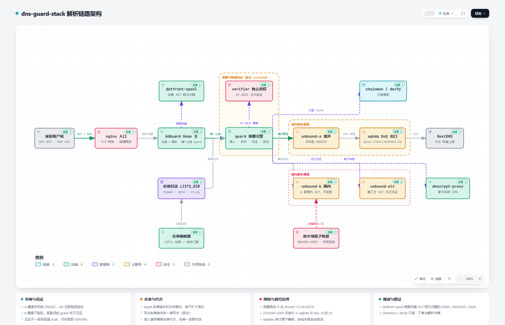

# dns-guard-stack

**面向自建场景的 DNS 解析与防护系统：加密上游、本机 DNSSEC 验证、国内外分流、答案准入和运行监控。**

本项目把 AdGuard Home、Unbound、DNSCrypt 与自研的 guard / verifier 组合在一台 Linux 服务器上。AdGuard Home 负责入口过滤和缓存，Unbound 负责解析及验证，guard 决定哪些候选答案可以交给客户端，verifier 提供独立进程核验。

它适合希望理解并控制整条解析链路的个人和运维人员，也可用于研究 DNS 投毒防护、缓存语义和多上游核对。部署需要 Docker、systemd、Nginx 和证书管理经验；安装脚本用于搭建基础环境，公网入口和安全验收仍需逐项完成。

> 本文按 2026-10-16 获取的仓库代码、配置模板及现有说明整理。端口和路径均指仓库默认布局，不代表任意部署的实时状态。历史运行数据和一次探针通过，不等于长期可靠性保证。

## 阅读导航

- [系统架构与交互图](#系统架构与交互图)
- [一次查询如何完成](#一次查询如何完成)
- [防护机制与信任边界](#防护机制与信任边界)
- [部署前准备](#部署前准备)
- [安装与入口接入](#安装与入口接入)
- [验收与客户端配置](#验收与客户端配置)
- [日常运维与排错](#日常运维与排错)
- [代码与详细文档](#代码与详细文档)

## 系统架构与交互图

<picture>
  <source media="(prefers-color-scheme: dark)" srcset="docs/assets/architecture-dark.png">
  
</picture>

**[打开交互架构 HTML](docs/assets/architecture.html)** · [浅色大图](docs/assets/architecture-light.png) · [深色大图](docs/assets/architecture-dark.png)

交互版就是项目配套的 `dns-guard-stack.html`，在仓库中统一保存为 `docs/assets/architecture.html`。它支持缩放、主题切换和节点源码跳转，适合结合下表逐层阅读。

GitHub 文件页面通常显示 HTML 源码；克隆仓库后，用浏览器打开该文件即可查看交互效果。图中的源码链接固定到生成图时的提交，便于追溯；后续代码变化以当前仓库为准。

```text
客户端
  │ DoT :853 / DoH :444（:443 需另接现有 HTTPS 站点）
  ▼
Nginx：TLS 终结、请求入口和限流
  ▼
主 AdGuard Home（adgh）：过滤、缓存；DNS 上游只指向 guard
  ▼
guard：国内路由判定 → 候选解析 → 安全检查 → 答案准入
  ├─ A：Unbound A（本机 DNSSEC）→ aghdq → NextDNS（DoQ）
  ├─ B：Unbound B → 国内 DoT 上游（只用于国内路由域名）
  ├─ alt：独立第三方 DoT → 本机 Unbound alt（核对 / 备用）
  └─ verifier：通过本机 Unix socket 协作的独立核验进程

旁路：DNSCrypt 候选与影子对比、名单刷新、防火墙对账、探针、监控看板
```

| 组件 | 具体作用 | 运行方式 / 代码 |
|---|---|---|
| Nginx | 提供 DoT / DoH 入口；DoH 精确转发 `/dns-query` | `deploy/nginx/` |
| 主 AdGuard Home：`adgh` | 客户端入口、过滤和缓存；没有配置绕过 guard 的备用 DNS | Docker；`deploy/containers/adgh.AdGuardHome.yaml.tpl` |
| guard | 分流、候选检查、见证、缓存和最终答案选择 | 宿主 systemd；`core/guard.py`、`core/answer_policy.py` |
| verifier | 独立进程核验，握手检查代码版本；并非另一台独立服务器 | 宿主 systemd；`core/verifier.py` |
| Unbound A：容器名 `unbound` | 本机验证 DNSSEC；经 aghdq 转发到加密上游 | Docker；`deploy/containers/unbound-a.conf.tpl` |
| `aghdq` | 第二个 AdGuard Home，专门充当 A 侧 DoQ 出口 | Docker；默认上游 `quic://dns.nextdns.io` |
| Unbound B | 国内 DoT 解析候选；其答案仍受 guard 策略约束 | Docker；`deploy/containers/unbound-b.conf.tpl` |
| Unbound alt | 独立第三方 DoT 路径，参与核对和受门禁约束的备用解析 | Docker；`core/alt_adapter.py`、readiness 检查 |
| DNSCrypt | 加密候选与影子采样，不能把它的应答直接当作 DNSSEC 证据 | Docker；`deploy/containers/dnscrypt-proxy.toml.tpl` |
| Chainmon | 展示服务器链路、统计和健康信息 | `dashboards/chainmon/` |
| devfp / dotfront-spool | 根据服务端可见的请求特征辅助归类来源；采集 DoT 解密后的本机内腿 | `dashboards/devfp/`、`tools/dotfront-spool.py` |

A、B、alt 是不同解析路径；`aghdq` 是 A 的出口，不是第四个独立验证器。图中的旁路采集与统计也不意味着每次查询都要等待所有组件。

## 一次查询如何完成

1. **接入。** 客户端经 DoT 或 DoH 到达 Nginx，再进入主 AdGuard Home。过滤规则或有效缓存可以直接给出结果，其余查询进入 guard。
2. **决定路由。** guard 根据类型化域名名单、例外规则等判断是否属于国内路径。命中国内路由只说明“可以向 B 查询”，不代表 B 的答案自动可信。
3. **获取候选。** 国内域名可优先尝试 B；其他域名主要使用 A。核对、备用和并发行为取决于当前策略、缓存及上游健康状况。
4. **判断能否采纳。** 检查报文是否对应原问题、地址是否可疑、证据是否过期，以及是否需要独立见证。本机 DNSSEC 验证和上游自报的 AD 位按不同证据强度处理。
5. **返回或拒绝。** 候选满足条件才返回；不满足时尝试策略允许的其他路径，仍无合格答案则失败。主 AdGuard Home 不设置绕过 guard 的 fallback。

“见证”是再向其他来源核对。它既可能用于确认答案，也可能专门核对域名是否存在；**存在性见证不等于要求所有解析器返回完全相同的 CDN 地址**。

## 防护机制与信任边界

| 机制 | 解决的问题 | 需要理解的边界 |
|---|---|---|
| DoT / DoQ / DNSCrypt | 降低公网传输过程中被伪造应答的风险 | 加密证明通道身份，不保证运营方的数据一定正确；默认 aghdq bootstrap 仍使用明文 DNS |
| 本机 DNSSEC 验证 | 对签名域名验证数据完整性 | 未签名域名无法获得同等保证；不能只看第三方返回 `AD=1` 就认定本机验签通过 |
| 路由与信任分离 | 防止社区名单误分类直接扩大信任范围 | `is_cn_domain()` 管路由；`is_cn_trusted()` 管免见证资格 |
| 国内答案见证 / 否决 | 限制伪造地址和把不存在域名伪造成存在的答案 | 默认 `known` 档允许指定后缀及人工白名单免见证，这是显式信任取舍 |
| TTL 与准入缓存 | 防止旧证据无限延长、名单撤销后继续复用 | 名单代次变化使相关准入失效；AdGuard Home 自身还有一层缓存 |
| 零 TTL 单次应答 | 处理特定可信国内 B 路径的零 TTL NXDOMAIN | 这是限定条件下的单次返回例外，不是把所有国内答案都改成零 TTL |
| 发布一致性检查 | 避免 guard 与 verifier 加载不同版本 | 独立进程仍共享宿主和权限边界，不等于抵御宿主 root 被攻陷 |
| 防火墙与地址对账 | 收紧容器 DNS 访问，封堵不允许的明文出口 | 必须检查规则实际生效；仅看到容器运行不能证明出口已收口 |

### 国内信任档位

| `CN_TRUST_MODE` | 含义 |
|---|---|
| `none` | 国内候选也要求见证，信任范围最保守 |
| `known`（默认） | 指定国别 / 品牌后缀和人工白名单可免见证，其余国内候选要求见证 |
| `all` | 扩大到全部国内路由域名，通常不建议使用 |

白名单授权不能替代 DNSSEC；例外名单、否决名单和可疑地址检查仍需结合具体策略理解。详细规则见 [安全说明](docs/SECURITY.md) 和 [系统详解](docs/DNS-SYSTEM-GUIDE.md)。

### 项目能力的边界

- **单机系统。** 多个解析组件不能消除宿主、网络、Nginx 和证书的单点故障。
- **默认没有用户级 DNS 鉴权。** 对外提供入口前，应决定服务范围、访问控制与容量限制。
- **多来源一致不等于密码学证明。** 多个来源也可能依赖相同数据或返回相同错误。
- **名单归档验签不证明上游名单正确。** 哈希与可选 GPG 签名用于落盘完整性和追溯。
- **监控只能描述服务器可见现象。** NAT、代理和客户端实现会影响来源识别；devfp 不能保证精确识别每台设备，也不能证明客户端应用实际使用了某个答案。

## 部署前准备

| 项目 | 要求 |
|---|---|
| 操作系统 | Linux，具备 systemd 和 root 权限；当前安装脚本要求 systemd |
| 容器运行时 | Docker 与 Compose 插件，支持脚本使用的 `up --wait` |
| Python | 安装脚本最低检查为 Python 3.6；目标环境仍应运行回归验证 |
| 基础工具 | Bash、OpenSSL、curl、常用 GNU 工具；防火墙部分使用 iptables / iptables-restore |
| Nginx | 需支持 HTTP TLS 和 stream TLS；模板含 HTTP/2、限流及自定义日志配置依赖 |
| 域名与证书 | 自有域名及匹配的 TLS 证书；自签证书仅适合已配置客户端信任的验证环境 |
| 网络 | 能访问镜像仓库、名单源及选定的 DoT / DoQ / DNSCrypt 上游 |

默认 Docker 网段为 `172.18.0.0/16`，alt 副本网段为 `10.99.0.0/24`。已有网络冲突时，需要一起调整网段、各组件 IP、模板和规则，并核验生成结果。

### 默认端口

| 端口 / 地址 | 用途 | 暴露范围 |
|---|---|---|
| TCP `853` | Nginx DoT 入口 | 按需对客户端开放 |
| TCP `444` | Nginx DoH，路径 `/dns-query` | 按需对客户端开放 |
| TCP `443` | 可在现有 HTTPS 站点接 DoH | 需额外配置；不是 Compose 自动提供 |
| `172.18.0.1:5355` | guard DNS | Docker 桥接网关上的内部接口 |
| `127.0.0.1:5353 / 5354 / 5357` | A / B / alt 的 DNS 映射 | 本机 |
| `127.0.0.1:5533 / 5399` | aghdq / DNSCrypt 的 DNS 映射 | 本机 |
| `127.0.0.1:3000 / 13000` | 两个 AdGuard Home 管理接口 | 本机，建议通过 SSH 隧道访问 |
| `127.0.0.1:4443 / 8854` | 主 AdGuard Home 的 HTTPS / DoT 映射 | 本机 |
| `8787 / 8789` | Chainmon / devfp 默认服务端口 | 启用前核对监听地址和鉴权 |

guard 默认使用的是 **dnsnet 自定义网络的网关**，不要把它误认为 `docker0` 的地址。公网入口与本机、容器内部的明文 DNS 跳转也应分别理解。

## 安装与入口接入

### 1. 获取代码并配置

```bash
git clone https://github.com/Logic769/dns-guard-stack.git
cd dns-guard-stack
cp .env.example .env
```

编辑 `.env`，至少核对以下配置：

```dotenv
DNS_DOMAIN=dns.example.com
TLS_CERT=/absolute/path/to/fullchain.pem
TLS_KEY=/absolute/path/to/privkey.pem
LISTS_PROFILE=fetch
CN_TRUST_MODE=known
INSTALL_NGINX=0
```

将域名和证书路径换成自己的值；管理账号密码通过本机 `.env` 设置，不要提交到仓库。先确认 Docker 网段、已有端口、上游可达性和证书域名一致。

### 2. 预览并安装

安装会向 `/opt`、`/etc/systemd/system` 和 `/usr/local/sbin` 写入文件，启动容器与服务，并默认应用项目防火墙规则。在已有 DNS 服务器上操作前，应先备份配置、服务单元、名单和现有规则。

```bash
sudo bash install.sh --dry-run
sudo bash install.sh --fetch-lists
```

`--dry-run` 仍要求存在可加载的 `.env` 和前置工具；应先完成上面的复制与编辑。

| 参数 | 作用 |
|---|---|
| `--dry-run` | 预览安装动作 |
| `--fetch-lists` | 安装时拉取真实名单 |
| `--skip-firewall` | 跳过安装阶段的规则应用；使用后需自行补齐并验收 |

安装主要完成代码复制、容器配置生成、容器启动、名单初始化、guard / verifier 单元安装，以及 Nginx 片段生成。**脚本运行结束不代表服务已经可对外使用。**

### 3. 核对当前安装脚本的限制

以下是按当前实现整理的接入检查项；旧说明或配置注释与代码冲突时，以实现和生成文件为准：

- **真实名单必须可用。** `.env.example` 默认 `LISTS_PROFILE=fetch`；`minimal` 只生成骨架。启用国内信任时，如果缺少有效否决策略，guard 可能拒绝启动，不能把骨架模式当作完整解析服务。
- **证书需要实际接入。** 模板不包含证书或私钥；脚本从本机文件读取并写入两份 AGH 配置，生成文件权限为 `0600`。Nginx 模板路径仍需单独核对，确保两处证书与域名一致。当前脚本未实现 `.env` 注释提到的 ACME 签发 / 续期流程。
- **部分上游变量没有接入渲染。** `UPSTREAM_B` 有专门替换逻辑；`UPSTREAM_A_QUIC`、`UPSTREAM_A_BOOTSTRAP`、`UPSTREAM_ALT` 不能仅靠修改 `.env` 就认定生效。调整对应模板并检查运行时文件。
- **Nginx 默认只生成片段。** 文件位于 `/opt/dns-guard-stack/runtime/nginx/`。需按 HTTP / stream 上下文分别接入，补齐 `dohfrag` 日志格式、`perip` 限流区、证书路径和发行版 CA 路径。校验通过后再重载。
- **看板需要单独启用。** 安装会复制看板文件，但不会自动启动 Chainmon / devfp；鉴权和日志来源也需自行配置。不要仅凭 `.env` 中有 `DASH_PASSWORD` 就认为鉴权已启用。
- **自动化需要核对实际启用状态。** 仓库包含多个 timer 和名单刷新工具，不能仅因文件存在就假定已定时运行。用 `systemctl list-timers` 和本机任务配置确认。

### 4. 接入 Nginx

DoT 片段放入 Nginx 的 `stream` 配置上下文；DoH 片段放入 `http` 上下文。模板默认采用宝塔目录，其他环境需调整。

```bash
# 完成片段接入及证书配置后，先做语法校验
sudo nginx -t
```

确认校验成功且变更影响可接受后，重载 Nginx。若要使用标准 `443` 端口，在已有 HTTPS 站点中接入 `/dns-query`，同时保留管理接口的访问隔离。

完整部署资料见 [DEPLOY.md](docs/DEPLOY.md)；其中关于 docker0、ACME、骨架名单及自动启动的旧描述，应结合以上实现限制阅读。

## 验收与客户端配置

### 服务端检查

```bash
sudo bash verify.sh --quick
sudo bash verify.sh
```

快速检查用于查看容器、服务和指标；完整检查会进一步发起 DNS 查询、检查入口和部分防火墙状态。**必须阅读 WARN：入口未接入等情况可能只告警，而不令整体返回失败。** 当前脚本的 DoH 检查也不能替代客户端侧的证书验证与 DNS 报文验收。

建议逐项确认：

| 检查 | 预期 |
|---|---|
| guard / verifier | 服务正常，握手和发布一致性检查通过 |
| 签名域名，如 `cloudflare.com` | 正常解析；本机验证路径应给出可核实的 DNSSEC 结果 |
| 已知错误签名域名 `dnssec-failed.org` | 返回 `SERVFAIL`；需结合正例及日志排除单纯断网 |
| 国内域名，如 `www.qq.com` | 正常解析；无需强求未签名答案具有 AD 位 |
| 公网 DoT / DoH | 从外部网络实际查询，证书链和域名校验成功，DNS 返回码与内容正确 |
| 防火墙与名单 | 规则检查通过，真实名单加载成功，没有意外明文回退 |

内部 guard 探测示例（按实际网关调整）：

```bash
dig @172.18.0.1 -p 5355 cloudflare.com +dnssec
dig @172.18.0.1 -p 5355 dnssec-failed.org +dnssec
dig @172.18.0.1 -p 5355 www.qq.com
```

这些命令只测试内部 DNS，不验证公网 TLS。加密入口可使用支持 DoT / DoH 的客户端或仓库 `probes/` 下的入口探针，先阅读对应参数；不要假定所有系统自带的 `dig` 都支持 `+tls`。

### 客户端填写什么

假设你的域名是 `dns.example.com`，且相应入口已完成配置：

| 客户端设置 | 填写示例 |
|---|---|
| Android「私人 DNS」提供商主机名 | `dns.example.com`（使用标准 DoT 853） |
| 支持 DoT URI 的客户端 | `tls://dns.example.com:853`，具体格式以客户端为准 |
| DoH 地址（默认独立入口） | `https://dns.example.com:444/dns-query` |
| DoH 地址（已接入 443 时） | `https://dns.example.com/dns-query` |

`172.18.0.1:5355` 是服务器内部接口，不应作为公网客户端地址。公网入口使用自签证书时，普通客户端通常不会自动信任。

## 日常运维与排错

以下示例使用默认安装目录。查看服务和健康信息：

```bash
systemctl is-active dnsguard dnsguard-verifier
journalctl -u dnsguard -u dnsguard-verifier -n 80 --no-pager
tail -n 80 /var/log/dnsguard.log
docker compose ps
python3 /opt/dnsguard/release_consistency.py
```

guard 的单元将主要输出写入 `/var/log/dnsguard.log`，所以仅看 journal 可能不够。启用 Chainmon 后，还可检查 `http://127.0.0.1:8787/api/health` 与 `/api/metrics`。

### 名单维护

| 文件 | 用途 |
|---|---|
| `cn-domains-typed.txt` / `forwarding-rules.txt` | 国内路由分类及转发规则 |
| `cn-trust-allow.txt` | 人工信任授权 |
| `cn-trust-exceptions.txt` | 国内分流例外 |
| `cn_veto.txt` / `cn_ip.txt` | 否决与国内 IP 判断 |

```bash
# 会更新本地名单；更新前保留可回滚副本
sudo bash /opt/dnsguard/tools/refresh-all-cn-lists.sh
python3 /opt/dnsguard/tools/verify-cn-lists.py
```

刷新包括下载、检查、原子替换及变更归档。更新后检查加载统计和实际解析；涉及信任撤销时，还应评估 AGH 缓存是否需要清除，参见 [运维文档](docs/OPERATIONS.md)。

### 发布与回滚

`tools/deploy_release.sh` 面向已有 `releases/<id>`、`RELEASE.sha256` 和 `current` 布局的环境，可做校验、切换及失败回滚。**基础安装使用的平铺布局不等于已经完成这套发布目录迁移。** 使用前先按 [迁移说明](docs/MIGRATION.md) 核对两个服务的实际启动路径。

### 常见现象

| 现象 | 优先检查 |
|---|---|
| 安装结束但 guard 反复重启 | `/var/log/dnsguard.log`、真实否决名单、状态目录和权限 |
| 容器 running，但查询超时 | 容器内部解析是否可用、dnsnet 网关、AGH 上游、防火墙与上游连通性 |
| DoT 连接失败 | 公网 853、stream include、TLS 证书与服务监听 |
| DoH 返回 502 | AGH `4443`、AGH 证书、Nginx 上游证书校验与错误日志 |
| 全部返回 SERVFAIL | A / alt 连通性、验证器状态、名单和日志；不要先关闭准入策略 |
| 国内结果异常或慢 | B 的可用性、路由名单、信任档位、见证 / 否决统计 |
| 看板没有数据 | 是否单独启动、统计文件和日志路径是否匹配，而非只看网页能否打开 |

## 代码与详细文档

```text
core/          解析核心、答案策略、verifier、alt 适配与就绪检查
tools/         名单刷新、归档校验、发布门禁、快照和采集工具
probes/        入口、链路、外部与专项探针
firewall/      规则生成、应用与容器地址对账
dashboards/    Chainmon 和 devfp
deploy/        容器模板、systemd 单元、Nginx 片段和名单样例
tests/         回归测试及在线验证工具
docs/          详细说明；assets/ 中保存静态与交互架构图
```

离线回归入口：

```bash
bash tests/run.sh
# 指定解释器，例如验证目标服务器的兼容性
PYTHON=python3.6 bash tests/run.sh
```

测试入口把模块复制到临时目录，按发布布局执行 `test_*.py`；具体测试数随版本变化。离线回归不能代替真实证书、Docker 网络、公网入口和上游故障场景验收。

| 文档 | 适合解决的问题 |
|---|---|
| [系统通俗详解](docs/DNS-SYSTEM-GUIDE.md) | 想了解各模块、脚本和判断方式 |
| [架构说明](docs/ARCHITECTURE.md) | 想查分层、接口、状态文件和查询流程 |
| [部署说明](docs/DEPLOY.md) | 准备部署，需结合本文的脚本限制核对 |
| [运维手册](docs/OPERATIONS.md) | 名单、发布、探针、看板与资源管理 |
| [安全模型](docs/SECURITY.md) | 威胁假设、信任取舍和防护边界 |
| [迁移说明](docs/MIGRATION.md) | 从现有部署迁移或重建 |
| [交互架构图](docs/assets/architecture.html) | 用浏览器查看全景并追溯生成时的源码 |

## 许可证

本仓库自研代码采用 [MIT License](LICENSE)。AdGuard Home、Unbound、DNSCrypt、外部名单及架构页内嵌字体等第三方内容遵循各自的许可证。
